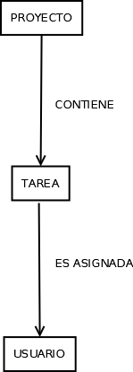

# PARTE 1. ANALIZAR EL PROBLEMA

| Posible objeto | ¿Por qué existe? | ¿Qué información necesita? |
|----------------| ----------------|----------------|
| Proyecto | La aplicación debe crear proyectos, además toda la tarea deberá estar asignada a un proyecto | Identificador, descripción, fecha creación, fecha entrega |
| Tarea | Un proyecto se compondrá de tareas | Identificador, título, descripción, usuario que ha creado la tarea, usuario al que se la ha asignado la tarea, fecha de creación, fecha de finalización, estado |
| Usuario | La aplicación necesitará usuarios que crearán las tareas y a los que se les asignará tareas | DNI, nombre completo, email |

 

**¿Qué otras entidades podrían existir?**

Yo añadiría una entidad Grupo, ya que los proyectos es habitual que estén asociados a un grupo de trabajo formado por usuarios.

 

**¿Cuáles son realmente necesarias?**

Proyecto, Tarea y Usuario

 

**¿Cuáles son solamente datos o características de otras entidades?**

Estado, esta entidad se usa solamente para asignar el estado de la tarea y podríamos guardar esta información en unas variables constantes.

# Parte 2. Identificar el estado

**PROYECTO**

Estado: - Identificador - Titulo - Fecha creación - Fecha entrega

**TAREA**

Estado: - Identificador - Titulo - Descripción - Proyecto asociado - Usuario responsable - Fecha creación - Fecha finalizacion - Estado

**USUARIO**

Estado: - Identificador - DNI - Nombre - Apellido

# Parte 3. Identificar el comportamiento

**PROYECTO**

Puede:

- crearProyecto
- consultarTareas

**TAREA**

Puede:

- crearTarea
- asignarUsuario
- cambiarEstado
- consultarTareas

**Usuario**

Puede:

- crearUsuario

# Parte 4. Responsabilidades
| Acción | Objeto responsable | ¿Por qué? |
|--------|----------------------|------------|
| Completar una tarea | Tarea |  Desde la tarea cambiamos su estado  |
| Iniciar una tarea | Tarea | Desde la tarea cambiamos su estado |
| Asignar responsable | Tarea | La tarea tiene reflejado su responsable |
| Crear proyecto | Proyecto | Desde proyecto se gestiona la creación de proyectos |
| Añadir tarea al proyecto | Proyecto | Desde el proyecto se guarda el listado de tareas |

# Parte 5. Diseñar el modelo
